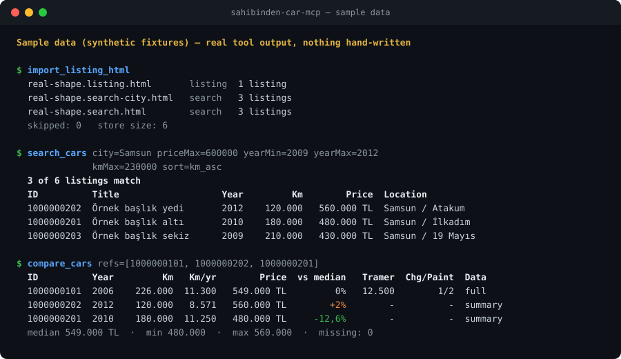

# sahibinden-car-mcp

> **TR özet:** Sahibinden.com otomobil ilanlarını, *sizin kendi tarayıcınızda kaydettiğiniz* HTML sayfalarından okuyup Claude'a (MCP üzerinden) filtreleme, ilan detayı ve karşılaştırma araçları sunan yerel bir MCP sunucusu. Varsayılan modda sahibinden.com'a **hiçbir ağ isteği göndermez**, bot korumasını atlatmaz, hesap/cookie istemez. İsteğe bağlı, **varsayılan kapalı** bir *tarayıcı modu* vardır; riskleri için [Browser mode](#browser-mode-opt-in--tarayıcı-modu-isteğe-bağlı) bölümündeki uyarıyı okuyun. sahibinden.com ile resmi bir ilişkisi **yoktur**.

A local [Model Context Protocol](https://modelcontextprotocol.io) (MCP) server that lets Claude search, inspect and compare used-car listings from sahibinden.com, working only from pages **you saved yourself** in your own browser. An optional, **off-by-default** [browser mode](#browser-mode-opt-in--tarayıcı-modu-isteğe-bağlı) can instead open pages in a Chrome window you start yourself (read the warning there first).

> **Disclaimer / Yasal uyarı**
> This project is **not affiliated with, endorsed by, or officially connected to sahibinden.com** in any way. It is intended for **personal, non-commercial use only**. In its default mode sahibinden-car-mcp makes **no network requests to sahibinden.com**; it only parses, locally, pages you opened and saved to your own computer. It does not bypass bot protection and does not ask for or store any session information or cookies. The optional browser mode is off by default; see its warning below. Do not use it for bulk data collection, republishing or commercial purposes. Complying with sahibinden.com's terms of use is your own responsibility. Sellers' personal data (name, phone) is not processed. This is not legal advice.
>
> Bu proje sahibinden.com ile bağlantılı değildir, onaylanmamıştır ve sahibinden.com ile resmi bir ilişkisi yoktur. Yalnızca **kişisel, ticari olmayan** kullanım içindir. sahibinden-car-mcp varsayılan modda sahibinden.com'a **hiçbir ağ isteği göndermez**; yalnızca sizin kendi tarayıcınızda açıp bilgisayarınıza kaydettiğiniz sayfaları yerel olarak okur. Bot korumasını atlatmaz, oturum bilgisi/cookie istemez veya saklamaz. Toplu veri toplama, yeniden yayınlama ve ticari kullanım için kullanmayın. sahibinden.com kullanım koşullarına uymak kullanıcının sorumluluğundadır. Satıcıların kişisel verileri (ad, telefon) işlenmez. Bu bir hukuki görüş değildir.

## Why it does not scrape directly

sahibinden.com is protected by Cloudflare's managed challenge (HTTP 403 with `cf-mitigated: challenge`, even for `robots.txt`). Plain HTTP requests cannot get listing data, and this project deliberately does **not** try to get around that: no proxies, no headless/stealth browsers, no captcha solvers, no fingerprint spoofing, and no copying of your browser cookies (such as `cf_clearance`) into the tool.

Instead it uses an **inbox-based import flow**: you view the page in your normal browser as any user would, save it with `Cmd+S` (`Ctrl+S` on Windows/Linux), and the MCP server parses the saved file locally. In this default mode the server never touches the network.

The opt-in [browser mode](#browser-mode-opt-in--tarayıcı-modu-isteğe-bağlı) is a deliberate exception: it drives a visible Chrome window that **you** started, at a low fixed pace. It still uses no proxies, no stealth or fingerprint tricks and no captcha solving, and it stops as soon as a verification page appears.

## How it works

```
Your browser (Chrome/Firefox)                 sahibinden-car-mcp (local, stdio)
  open a search / listing page  ── Cmd+S ──▶  ~/.sahibinden-car-mcp/inbox/*.html
                                                       │  import_listing_html
                                                       ▼
                                        parser (label-based, cheerio) ──▶ local store.json
                                                       │
                                  search_cars · get_listing · compare_cars · ping
```

1. Ask Claude for a search. `search_cars` returns matching listings from your local store plus ready-made sahibinden search URL(s) for you to open.
2. Open the URL in your own browser.
3. Save the page with `Cmd+S` (format: "Webpage, Complete" or "HTML only") into `~/.sahibinden-car-mcp/inbox/`.
4. Tell Claude to import it. `import_listing_html` parses the new files, then you can search, open details and compare.

Search result rows usually do not show transmission or fuel. Save the individual listing page to get the full details (damage, paint/replaced parts, tramer, description and more).

## Quick install as a Claude Code plugin (no npm, no build) / Eklenti olarak kurulum

Needs only Node 22.12+ and Claude Code 2.1.275+. The repo ships a ready-made single-file server (`bundle/server.mjs`) and the `sahibinden-car` skill:

```
/plugin marketplace add gkdgbilal/sahibinden-car-mcp
/plugin install sahibinden-car@sahibinden-car
```

Terminal equivalent: `claude plugin marketplace add gkdgbilal/sahibinden-car-mcp && claude plugin install sahibinden-car@sahibinden-car`. Then just ask, e.g. "2015 Mercedes C200d otomatik, 200 bin km altı, en mantıklı 5 ilanı listele". Saved pages go to `~/.sahibinden-car-mcp/inbox`. (Contributors: `npm run bundle` regenerates `bundle/server.mjs`; commit it with source changes.)

## Requirements and installation

- Node.js 22.12 or newer (Node 20 is end-of-life; browser mode needs the built-in `WebSocket`)
- npm
- Google Chrome or Chromium, only for the optional browser mode

```bash
git clone https://github.com/gkdgbilal/sahibinden-car-mcp.git
cd sahibinden-car-mcp
npm install
npm run build
```

## Demo



The sample above comes from synthetic fixtures (no real listings) and is the actual output of the `import_listing_html`, `search_cars` and `compare_cars` tools. Regenerate it with `npm run build && npm run demo`.

## Connecting to Claude Code

Use the absolute path of the built entry point:

```bash
claude mcp add sahibinden-car --scope user -- node /ABSOLUTE/PATH/TO/sahibinden-car-mcp/dist/index.js
claude mcp list   # sahibinden-car should show as connected
```

To use a different data directory:

```bash
claude mcp add sahibinden-car --scope user -e SAHIBINDEN_MCP_HOME=/path/to/data -- node /ABSOLUTE/PATH/TO/sahibinden-car-mcp/dist/index.js
```

For Claude Desktop, add this to `claude_desktop_config.json`:

```json
{
  "mcpServers": {
    "sahibinden-car": {
      "command": "node",
      "args": ["/ABSOLUTE/PATH/TO/sahibinden-car-mcp/dist/index.js"]
    }
  }
}
```

## Tools

| Tool | Purpose | Main parameters |
|---|---|---|
| `search_cars` | Filters and sorts imported listings; also returns sahibinden search URLs for you to open in your browser. **Every filter is applied both locally and in the URL** (only `page` is URL-only and `limit` local-only, by nature). Price filters are in `priceCurrency` (default TL); listings in another currency are excluded (no conversion) and counted in `excludedOtherCurrency`. Listings with a missing filter field are returned with an `unknownFields` marker (`unknown: 'include'`, default) or dropped and counted in `excludedUnknown` (`unknown: 'exclude'`). The output also lists `appliedFilters` and `urlOnlyFilters` (empty). Audit table: `docs/05-FILTER-AUDIT.md`. | `city`, `brand`, `models[]` (max 10), `priceMin`, `priceMax`, `transmission` (`manual`/`automatic`/`semi-automatic`), `fuel` (`gasoline`/`diesel`/`lpg`/`hybrid`/`electric`), `yearMin`, `yearMax`, `kmMin`, `kmMax`, `sort` (`price_asc` default, `price_desc`, `year_desc`, `year_asc`, `km_asc`, `km_desc`, `date_desc`, `date_asc`), `sellerType`, `bodyType`, `color`, `vehicleCondition`, `enginePower` (up to 601+ hp), `engineVolume`, `drivetrain`, `exchange`, `warranty`, `listedWithin` (`1day`...`30days`), `unpaintedOnly`, `noReplacedParts`, `noHeavyDamage`, `priceCurrency` (`TL` default, `USD`, `EUR`, `GBP`), `page` (URL only), `limit` (1-100, default 20), `unknown` (`include` default / `exclude`; old `includeUnknown: false` = `exclude`) |
| `get_listing` | Full details of an imported listing (damage, paint/replaced parts, tramer, description, seller type). If only a search row is stored it returns a summary plus a hint to save the detail page. | `ref` (listing number or listing URL) |
| `compare_cars` | Puts 2-10 listings side by side with age, km per year and price difference versus the set median. Market interpretation is left to Claude. | `refs[]` (2-10 listing numbers or URLs) |
| `import_listing_html` | Imports saved sahibinden search/listing pages. Without `path` it processes new files in the inbox; `path` must be inside the inbox (relative paths resolve against it). Detects half-loaded or challenge pages and reports them as skipped. | `path`, `html` (small snippets only, max 5 MB), `sourceUrl`, `force` |
| `ping` | Health check: version, active provider, number of listings in the local store, inbox directory, and `browserMode` (`disabled` / `enabled`). | `msg` (optional) |
| `browser_status` | **Only registered when browser mode is on.** Shows whether Chrome is reachable, rate-limit counters and any pending verification. Never opens sahibinden.com. | none |
| `live_search` | **Only registered when browser mode is on.** Same filters as `search_cars` plus `maxPages` (default 3, hard maximum 10): opens the search pages in your dedicated Chrome, imports them through the normal parser/store and returns the matching listings plus a `live` report (status, per-page visits, `freshIds`, `notVisited`, `userAction`). Meant to be used only when you ask for a live/fresh search. | all `search_cars` parameters, `maxPages` |
| `live_get_listings` | **Only registered when browser mode is on.** Opens the detail pages of up to 10 listings (default 3) and imports them (damage, tramer, description); detail pages imported within the last 24 h are skipped (`skipKnown`). Then use `get_listing` / `compare_cars`. | `refs[]` (1-10 listing numbers or URLs), `maxListings`, `skipKnown` |

The listing `description` field is free text written by the seller and is treated as untrusted; the tool descriptions tell the model not to follow instructions found in it.

## Browser mode (opt-in) / Tarayıcı modu (isteğe bağlı)

> **⚠️ Experimental, OFF by default / Deneysel, varsayılan KAPALI**
>
> **TR:** Tarayıcı modu açıldığında bu araç, **sizin bilgisayarınızda, sizin başlattığınız** ayrı bir Chrome profilini kullanarak sahibinden.com sayfalarını sizin adınıza açar ve okur. Bu, **otomatik erişim** sayılabilir ve sahibinden.com kullanım koşullarına **aykırı kabul edilebilir**; siteye erişiminiz veya hesabınız **kısıtlanabilir ya da kapatılabilir**. Bu modu kullanıp kullanmamak ve sonuçları tamamen **sizin sorumluluğunuzdadır**. Bu bir hukuki görüş değildir.
>
> Bu mod bilinçli olarak sınırlıdır: bot korumasını **atlatmaz**, gizleme/parmak izi taklidi yapmaz, captcha veya Cloudflare doğrulamasını **çözmez**; doğrulama sayfası görürse durur ve doğrulamayı **sizin** geçmenizi ister. Sayfalar arasında en az 5 saniye bekler, bir istekte en fazla 10 sayfa açar, toplu veya arka planda tarama yapmaz. Satıcı adı/telefonu okunmaz, sayfa HTML'i saklanmaz, cookie okunmaz.
>
> Öneriler: adanmış profilde sahibinden hesabınıza **giriş yapmayın**; bu profili başka siteler için kullanmayın; işiniz bitince bu Chrome penceresini kapatın. **Güvenlik:** Chrome hata ayıklama portu açıkken bilgisayarınızdaki diğer programlar da bu profili kontrol edebilir.
>
> **EN:** When enabled, this tool uses a separate Chrome profile that you start yourself to open and read sahibinden.com pages on your behalf. This may count as automated access and may violate sahibinden.com's terms; your access or account may be restricted or closed. Use at your own risk; this is not legal advice. It does not bypass bot protection, does not hide or spoof anything and does not solve captchas or Cloudflare checks (it stops and asks you to pass them yourself), waits at least 5 s between pages, opens at most 10 pages per request and never crawls in bulk or in the background. While the debugging port is open, other local programs could control that profile.

The semi-automatic `Cmd+S` + `import_listing_html` flow described above **is still the default** and the recommended path. Browser mode is an optional shortcut on top of it; if sahibinden.com keeps showing verification pages, just keep using the import flow (see [Known limitations](#known-limitations)).

### How it works

Claude never starts Chrome. **You** start a dedicated Chrome window with its own profile (`npm run chrome`), and the MCP server only connects to it over the local DevTools port, opens a fresh tab per call, hands the page HTML to the same parser/store as the import flow, and closes the tab. Search results always come from the local store, so `live_search` filters and sorts exactly like `search_cars` (same `appliedFilters`, same unknown-field policy).

### Setup (from a repository clone; `scripts/` is not part of the npm package)

1. Node.js 22.12+ and Google Chrome (or Chromium) installed; `npm install && npm run build`.
2. Register the server with the mode switched on (otherwise the three live tools are not even registered):

   ```bash
   claude mcp add sahibinden-car --scope user -e SAHIBINDEN_BROWSER_MODE=on -- node /ABSOLUTE/PATH/TO/sahibinden-car-mcp/dist/index.js
   ```

3. Start the dedicated Chrome window yourself (`npm run chrome -- --dry-run` only prints what would be started):

   ```bash
   npm run chrome
   ```

   The profile lives in `~/.sahibinden-car-mcp/chrome-profile` (override with `SAHIBINDEN_BROWSER_PROFILE_DIR`). The launcher refuses Chrome's default data directory and never touches your normal Chrome session.
4. In that window, open sahibinden.com **yourself** once. If a verification page appears, pass it yourself. **Do not log in**: search and listing pages do not need an account, and anonymous use greatly reduces the account risk. Do not use this profile for other sites.
5. Ask Claude for a live search, for example "search live: 2015+ automatic Golf in Samsun, 1 page". `browser_status` tells you whether Chrome is reachable.
6. When you are done, close the dedicated Chrome window (this also closes the debugging port).

### Limits (fixed, enforced across processes)

| Limit | Value |
|---|---|
| Gap between two page loads | fixed, at least **5 s** (`SAHIBINDEN_BROWSER_DELAY_MS` can only raise it; no random jitter) |
| Pages per call | default **3**, hard maximum **10** |
| Pages per hour | default **30**, hard maximum **60** (state shared by every MCP process via `~/.sahibinden-car-mcp/browser-state.json`) |
| After a verification page | no new navigation for **60 s**, and none at all until the pending tab is clear |
| One call at a time | a lock file makes concurrent calls return `busy` |
| Total time per call | 180 s, then a partial result is returned |

### What happens when sahibinden.com shows a verification page

The call **stops immediately**. The tab stays open so that **you** can pass the check in the Chrome window; Claude is told not to retry on its own (`challenge-detected`). As long as that tab still shows a verification, further live calls return `challenge-pending` without opening any page. After you passed it and told Claude, a new call works again (after the 60 s cool-down). Nothing is ever clicked, solved or automated. If the site asks for a login (`login-required`) or shows something unexpected (`unexpected-page`) the call also stops.

Status values of the `live` report: `ok`, `partial`, `disabled`, `unsupported-runtime`, `not-running`, `challenge-detected`, `challenge-pending`, `login-required`, `unexpected-page`, `timeout`, `navigation-error`, `deadline`, `hourly-cap`, `busy`. They are returned as structured results (with a Turkish `message` and a `userAction`), not as errors.

### What it does and does not do

- Uses only an allow-list of ten DevTools methods; it does **not** emulate input, spoof user agents or fingerprints, patch `navigator`, use proxies, load extensions, read cookies or storage, or attach to your other tabs.
- Navigates only to `https://www.sahibinden.com/...` URLs built by the server itself; no arbitrary URLs from the model.
- Connects only to `127.0.0.1`. Raw page HTML is never written to disk, logs or tool output; seller name and phone are not read.
- Appends an audit line (time, URL, page type, HTTP status, imported count; no HTML) to `~/.sahibinden-car-mcp/browser-log.jsonl`.

### Security note (local debugging port)

While the dedicated Chrome is running, its DevTools port listens on `127.0.0.1` with a random port, and the port number is stored in the profile directory. **Any program running as your user on this computer** (a malicious npm package included) could connect to it and fully control that profile: read pages and cookies of that profile. A random port is not a security boundary. That is why the profile should be dedicated, anonymous (no logins, no other sites) and closed when you are done. A safer pipe-based mode is on the roadmap.

### Configuration (browser mode)

| Variable | Default | Meaning |
|---|---|---|
| `SAHIBINDEN_BROWSER_MODE` | off | Only `on`, `1` or `true` (case-insensitive) enables the three live tools. Anything else is off. |
| `SAHIBINDEN_BROWSER_PROFILE_DIR` | `~/.sahibinden-car-mcp/chrome-profile` | Dedicated Chrome profile directory; Chrome's default data directory is refused. |
| `SAHIBINDEN_CHROME_PATH` | auto-detected | Chrome executable; used only by `npm run chrome`. |
| `SAHIBINDEN_BROWSER_DELAY_MS` | `5000` | Gap between page loads; values below 5000 are raised to 5000. |
| `SAHIBINDEN_BROWSER_MAX_PAGES` | `3` | Default pages per call (1-10). The tool parameter `maxPages` is capped at 10. |
| `SAHIBINDEN_BROWSER_HOURLY_CAP` | `30` | Pages per hour (1-60). |
| `SAHIBINDEN_BROWSER_NAV_TIMEOUT_MS` | `30000` | Per-page timeout (5000-60000). |

Invalid values fall back to the default and print a warning on stderr; clamped values are visible in `browser_status`.

## Example prompts

- "Find Golf/Astra/Focus/Megane in Samsun, 700-900k TL, automatic, 2015 or newer, under 150k km. Sort by price/km/year and flag the ones more than 10% below the market."
  (Turkish: "Samsun'da 700-900 bin TL, otomatik, 2015+, 150 bin km altı Golf/Astra/Focus/Megane bul; fiyat/km/yıl oranına göre sırala; piyasanın %10 altındakileri işaretle.")
- "I saved two pages into the inbox, import them."
- "Compare these three listings and tell me which one has the least damage history."
- "Show the full details for listing 1234567890."

## Configuration

| Variable | Default | Meaning |
|---|---|---|
| `SAHIBINDEN_MCP_HOME` | `~/.sahibinden-car-mcp` | Data directory (contains `inbox/` and `store.json`) |
| `LOG_LEVEL` | `info` | `debug`, `info`, `warn` or `error`. Logs go to stderr only; stdout is reserved for the MCP protocol |

Browser-mode variables are listed in the [browser mode section](#configuration-browser-mode).

Built-in limits: saved files up to 10 MB, `html` argument up to 5 MB, descriptions truncated to 4000 characters.

## Where your data is stored

Everything stays on your machine, under `SAHIBINDEN_MCP_HOME`:

- `inbox/` : the pages you saved
- `chrome-profile/`, `browser-state.json`, `browser.lock`, `browser-log.jsonl` : only with browser mode (dedicated Chrome profile, rate-limit state, lock, URL-only audit log)
- `store.json` : parsed listings, de-duplicated by listing number, with capture time and price history. Each imported file is remembered by content hash plus parser version: an unchanged file is skipped as `duplicate`, but a file read by an older parser version is re-parsed automatically after an upgrade (price history is kept); pass `force: true` to re-parse regardless.

In the default mode nothing is sent anywhere by this tool; with browser mode on, the only traffic is the dedicated Chrome loading sahibinden.com pages. (Note that whatever Claude reads through the tools is, of course, processed by the Claude client you use.) Delete the directory to remove all data.

## Privacy (KVKK)

Seller name, phone number and profile links are **not parsed and not stored**. Only the seller type (owner / dealer / authorized dealer) is kept. Do not commit your inbox or store; both are in `.gitignore`.

## Known limitations

- Not fully automatic by default: you must open and save the pages yourself. This semi-automatic `Cmd+S` flow is **still the default** and the deliberate, legitimate way around the Cloudflare challenge.
- **Browser mode ([opt-in](#browser-mode-opt-in--tarayıcı-modu-isteğe-bağlı)) is experimental.** Cloudflare may ask for verification again and again (for example because the browser is remote-controlled); the tool never hides or solves it, it stops and waits for you. If that happens constantly, browser mode is not practical for you: use the import flow. It needs Node 22.12+, a locally installed Chrome that you start yourself, and it carries the terms-of-use / account risk described in its warning. It has been tested only against fake page sources so far (not yet against the live site); parser results on live pages can differ from saved pages.
- **URL filter parameters: mostly verified, a few assumptions remain** (full table in `docs/04-URL-SCHEMA.md`, verified 2026-11-18 from the site's own filter links in a real browser session).
  - *Verified:* category path (`/{brand}-{series}-{engine}`, e.g. `/opel-astra-1.3-cdti`), `price_min`/`price_max` (+ `price_currency`), `a5_min`/`a5_max` (year), `a4_min`/`a4_max` (km), `a6` (transmission), `a17` (fuel), `a706` (seller type), `a8` (body type), `a3` (color), `a113987` (vehicle condition), `a2320` (engine power ranges), `a1864` (engine volume ranges), `a9213` (drivetrain), `exchange`, `date`, `unpaintedParts`, `unchangingTracks`, `sorting` (8 values), `pagingOffset` (20 per page), and `address_city` (plate code; all 81 provinces checked against the official plate list in `tests/cities.test.ts`, tried live on the site for **Samsun (55) and Istanbul (34)** only). A combined filter URL was confirmed to return only matching listings.
  - *Not verified:* whether the site accepts `address_city` for the 79 provinces other than 55/34 (the plate codes themselves are verified; live acceptance is not), the semi-automatic transmission ID (unknown, never added to URLs), selecting several values of one filter at once, and which hybrid variant you want (`hybrid` maps to Benzin(Hibrit); the `note` lists the other IDs). All constants live in `src/sahibinden/url-schema.ts` with `verified` flags.
  - All `search_cars` filters (`sellerType`, `bodyType`, `color`, `vehicleCondition`, `enginePower`, `engineVolume`, `drivetrain`, `exchange`, `warranty`, `listedWithin`, `unpaintedOnly`, `noReplacedParts`, `noHeavyDamage`, `priceCurrency`) shape the URL **and** filter the local store. Detail-only fields (body type, drivetrain, condition, seller type, trade-in, warranty, heavy damage, engine, damage map) are only known for listings whose detail page you imported; for search-row-only listings they are "unknown" (marked, or excluded with `unknown: 'exclude'`). Details and rules: `docs/05-FILTER-AUDIT.md`.
- **Parser coverage:** checked against one real saved search page and one real saved listing page (2026-11-18), plus synthetic fixtures that copy the real structure. It matches Turkish field labels rather than CSS classes, returns `null` for unknown fields and attaches `warnings[]`; other categories or layouts may still reveal gaps.
- **Location cell format depends on the page.** Without a city filter the cell reads "Province District"; with a city filter it reads "District Neighborhood". The parser decides from `cityHint` (also accepted by `import_listing_html`), the page URL (city path segment or `address_city`) or a title starting with the city name. If signals conflict or cannot tell, `city`/`district` stay `null`, the raw text is kept in `locationRaw` and a warning is added; nothing is guessed. On city-filtered pages the first word is the district (a leading number joins the next word, e.g. "19 Mayıs") and the rest is `neighborhood`; `locationRaw` is kept there too because the split is heuristic.
- **Listing-page location is verified (2026-11-18)** against a real page: city/district/neighborhood come from the `Adres Breadcrumb` links (first = province, second = district, last = neighborhood), with the `#gmap` `data-*` attributes as fallback. If neither exists, location stays `null` with a warning.
- Search rows rarely include transmission/fuel; those become known after importing the listing page.
- Safari `.webarchive` files are not supported. Use Chrome or Firefox ("Webpage, Complete" or "HTML only").
- If the saved file loses its URL, the parser tries `link[rel=canonical]`, `og:url`, Chrome's `saved from url` comment, a URL built from the listing number, and finally the `sourceUrl` argument.
- Currency is never converted: with a price filter, listings in another currency than `priceCurrency` are excluded. `listedWithin` has day granularity. The semi-automatic transmission has no known sahibinden ID, so it is applied locally but not added to the URL.
- **Tramer is a seller claim:** when the structured field is missing, the tramer amount is read from the listing description (`tramerAmount` = sum of the amounts near the word "tramer", plus `tramerRecords` and `tramerStatus`: `none`, `amount`, `mentioned`, `unknown`). It is unverified; always run the official tramer query.
- Version 0.2.0 is early software.

## Development

```bash
npm run build       # compile TypeScript to dist/
npm run typecheck
npm test            # vitest
npm run smoke       # end-to-end check against dist/ in a temp home: browser mode off (5 tools), on without Chrome (8 tools), and a fake-page-source live flow; no real Chrome or network
npm run chrome      # optional browser mode: start the dedicated Chrome window (repo clone only); add -- --dry-run to preview
npm run demo        # regenerate docs/assets/demo.svg from real tool calls on synthetic fixtures
```

Parser and normalizer functions are pure (no I/O, no clock). Tests use only small, synthetic, anonymized fixtures; **never commit real listing HTML** (it contains third-party content and personal data). `tests/fixtures/private/` is git-ignored for local experiments.

## Roadmap

- Try `address_city` live for the remaining 79 provinces and validate the parser against more real saved pages
- `analyze_market_price` and `find_price_drops` (price history is already recorded in the store)
- Evaluate a `--remote-debugging-pipe` mode for browser mode (only the parent process could control Chrome; needs the MCP server to launch Chrome)
- Optional additional providers behind the existing `Provider` interface, only if sahibinden.com offers an official API or access policy changes

## License

[MIT](LICENSE) (c) 2026 Bilal Gökdağ. sahibinden.com is a trademark of its respective owner; this project is unaffiliated with it.
